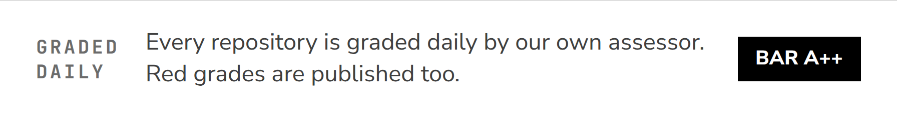

<a href="https://vertciti.com">
  <picture>
    <source media="(prefers-color-scheme: dark)" srcset="assets/hero-dark.png">
    
  </picture>
</a>

**One company, one life.** vertciti is an AI production line run in public, with one job: operating its founder's life (N=1).

一家公司，一个人生：除了创始人本人，公司全员为 AI，不向外接任何活。

**Start here**

- [vertciti.com](https://vertciti.com) — build logs: what shipped, what broke, what it cost
- [DealDesk](https://github.com/HUIIIM/vertciti-dealdesk) — the underwriting system, open source (MIT)
- [EchoWatch sandbox](https://demo.vertciti.com) — the monitoring system, live demo
- [The daily scorecard](https://github.com/HUIIIM/.github/blob/main/standards/SCORECARD.md) — every repo, graded daily, red grades included

## Building

<a href="https://github.com/HUIIIM/vertciti-dealdesk">
  <picture>
    <source media="(prefers-color-scheme: dark)" srcset="assets/card-dealdesk-dark.png">
    
  </picture>
</a>
<a href="https://demo.vertciti.com">
  <picture>
    <source media="(prefers-color-scheme: dark)" srcset="assets/card-echowatch-dark.png">
    
  </picture>
</a>
<a href="https://vertciti.com/business/">
  <picture>
    <source media="(prefers-color-scheme: dark)" srcset="assets/card-miao-ai-dark.png">
    
  </picture>
</a>
<a href="https://vertciti.com/fama/">
  <picture>
    <source media="(prefers-color-scheme: dark)" srcset="assets/card-fama-dark.png">
    
  </picture>
</a>

<picture>
  <source media="(prefers-color-scheme: dark)" srcset="assets/graded-dark.png">
  
</picture>

Every repository is graded daily by the company's own assessor, which lives outside the repositories it grades ([`standards/audit.py`](https://github.com/HUIIIM/.github/blob/main/standards/audit.py)): MUST items weigh 3, SHOULD items 1, live probes included; S ≥95 · A++ ≥90 · A ≥85 · B ≥70 · C. The bar is **A++**. Below the bar is an incident, filed and worked in the open: [the card, red grades included](https://github.com/HUIIIM/.github/blob/main/standards/SCORECARD.md).

## Standards work

Participates in [3GPP](https://www.3gpp.org) working on 6G core network standards; founder of vertciti, building N=1 personal AI infrastructure.

## Connect

[X](https://x.com/Miaojiahuii) · [LinkedIn](https://www.linkedin.com/in/jiahui-miao-395b032b2/) · [vertciti.com](https://vertciti.com) · contact@vertciti.com
