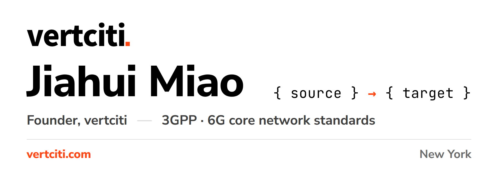
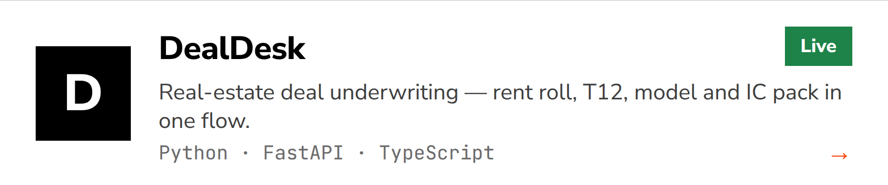
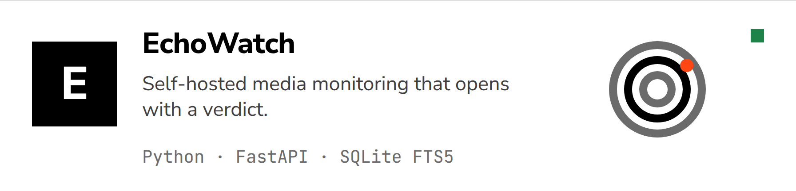
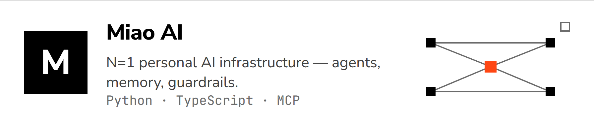
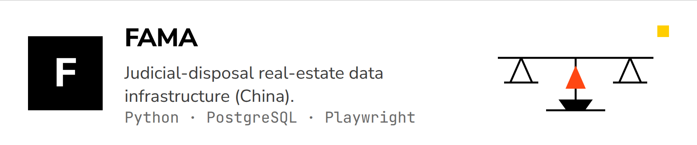

<a href="https://vertciti.com">
  <picture>
    <source media="(prefers-color-scheme: dark)" srcset="assets/hero-dark.png">
    
  </picture>
</a>

**One company, one life.** vertciti is an AI production line run in public, with one job: operating its founder's life (N=1).

一家公司，一个人生：除了创始人本人，公司全员为 AI，不向外接任何活。

**Start here**

- [vertciti.com](https://vertciti.com) — build logs: what shipped, what broke, what it cost
- [DealDesk](https://github.com/HUIIIM/vertciti-dealdesk) — the underwriting system, open source (MIT)
- [EchoWatch sandbox](https://demo.vertciti.com) — the monitoring system, live demo
- [The daily scorecard](https://github.com/HUIIIM/.github/blob/main/standards/SCORECARD.md) — every repo, graded daily, red grades included

## Building

<a href="https://github.com/HUIIIM/vertciti-dealdesk">
  <picture>
    <source media="(prefers-color-scheme: dark)" srcset="assets/card-dealdesk-dark.png">
    
  </picture>
</a>

**Live** — real-estate deal underwriting: rent roll, T12, model and IC pack in one flow. [Repository](https://github.com/HUIIIM/vertciti-dealdesk) · [Product page](https://vertciti.com/business/)
<a href="https://demo.vertciti.com">
  <picture>
    <source media="(prefers-color-scheme: dark)" srcset="assets/card-echowatch-dark.png">
    
  </picture>
</a>

**Live** — self-hosted media monitoring that opens with a verdict. [Live sandbox](https://demo.vertciti.com); source private.
<a href="https://vertciti.com/business/">
  <picture>
    <source media="(prefers-color-scheme: dark)" srcset="assets/card-miao-ai-dark.png">
    
  </picture>
</a>

**Private** — N=1 personal AI infrastructure (agents, memory, guardrails), in production for one; [project page](https://vertciti.com/business/).
<a href="https://vertciti.com/fama/">
  <picture>
    <source media="(prefers-color-scheme: dark)" srcset="assets/card-fama-dark.png">
    
  </picture>
</a>

**In development** — judicial-disposal real-estate data infrastructure (China), built for our own real-estate operations; not yet offered externally, not a product or service offering. [Project page](https://vertciti.com/fama/).

<!-- grading:start -->

**Graded daily.** 18 repos graded by the company's own assessor · 2026-10-30 · 7/18 at the bar (A++) — red grades published too: [the daily scorecard](https://github.com/HUIIIM/.github/blob/main/standards/SCORECARD.md).

<!-- grading:end -->

## Standards work

Participates in [3GPP](https://www.3gpp.org) working on 6G core network standards; founder of vertciti, building N=1 personal AI infrastructure.

## Connect

[X](https://x.com/Miaojiahuii) · [LinkedIn](https://www.linkedin.com/in/jiahui-miao-395b032b2/) · [vertciti.com](https://vertciti.com) · contact@vertciti.com
